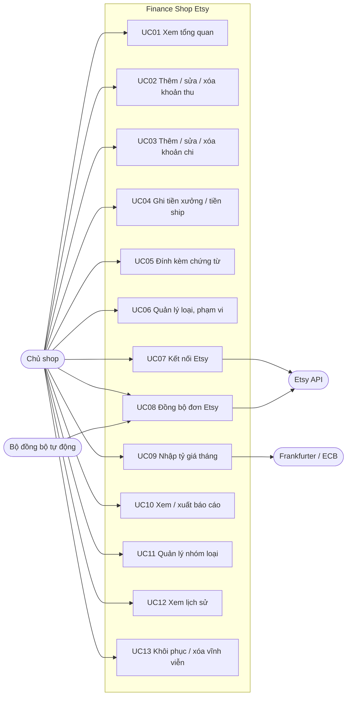
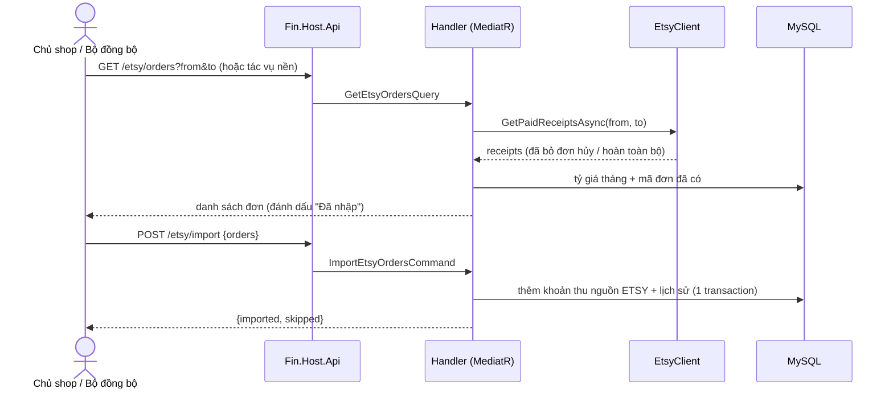

# Tác nhân và use case

## Tác nhân

| Tác nhân | Mô tả |
|---|---|
| **Chủ shop** | Người dùng duy nhất; dùng ứng dụng trên máy cá nhân, không đăng nhập |
| **Etsy API** | Hệ thống ngoài: cấp quyền OAuth, trả danh sách đơn (receipts) |
| **Frankfurter (ECB)** | Hệ thống ngoài: tỷ giá EUR/USD tham chiếu của Ngân hàng Trung ương châu Âu |
| **Bộ đồng bộ tự động** | Tác vụ chạy nền trong backend, mỗi phút kiểm tra đã đến lượt đồng bộ Etsy chưa |

## Sơ đồ use case

## Luồng chính

### UC02 Thêm khoản thu

1. Chủ shop bấm **Thêm khoản thu**, nhập ngày, loại, tên sản phẩm, số tiền trước thuế, % thuế (các trường có `*` là bắt buộc).
2. (Tùy chọn) nhập tiền xưởng / tiền ship.
3. Bấm **Lưu khoản thu**.
4. Backend kiểm tra dữ liệu, kiểm tra loại thuộc đúng nhóm "thu", kiểm tra khóa sổ, lưu, ghi lịch sử.
5. Nếu có tiền xưởng / ship: backend tạo khoản chi gắn với khoản thu (UC04).
6. Giao diện mở panel chi tiết của khoản vừa thêm.

**Ngoại lệ:** ngày thuộc kỳ đã khóa sổ → thông báo "Quý x/yyyy đã khóa sổ…"; loại không thuộc khoản thu → "Danh mục không thuộc loại thu/chi đã chọn.".

### UC04 Ghi tiền xưởng / tiền ship

1. Trong panel chi tiết khoản thu, nhập số tiền đã trả (gồm thuế), % thuế, ID hóa đơn, ngày chi.
2. Backend: chưa có khoản chi gắn kèm → tạo mới (loại "Tiền xưởng" nếu ngoài EU, "Phí ship" nếu trong EU, tự tạo loại nếu chưa có); đã có → cập nhật số tiền, % thuế, ngày, ID hóa đơn.
3. Số tiền 0 → chuyển khoản chi gắn kèm vào thùng rác.

### UC08 Đồng bộ đơn Etsy

### UC13 Thùng rác

Xóa khoản → vào thùng rác (kèm khoản chi tiền xưởng / ship gắn với nó). Khôi phục → khôi phục cả khoản chi gắn kèm. Sau 30 ngày (hoặc khi bấm xóa vĩnh viễn / làm trống) → xóa hẳn dòng và file chứng từ.
