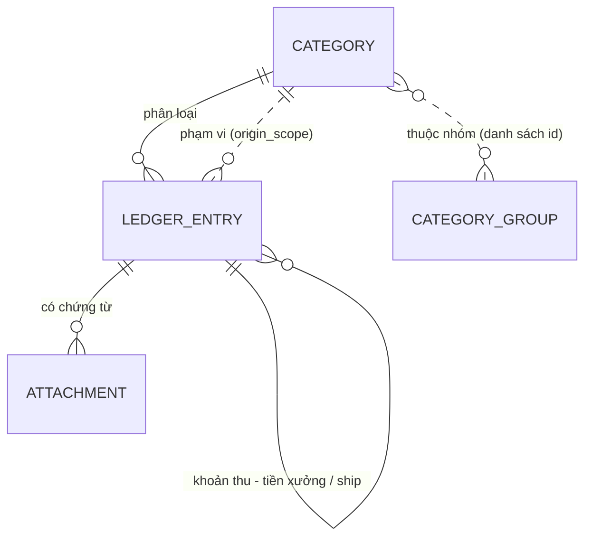

# Mô hình dữ liệu

Entity nằm ở `backend/Modules/Finance/Fin.Domain.Finance/Entities`, ánh xạ bảng ở `Fin.Infrastructure.Finance/Contexts/Configurations`. Sơ đồ bảng và migration: [DATABASE.md](DATABASE.md).

## Entity

### `LedgerEntry` — một khoản thu hoặc khoản chi (bảng `ledger_entries`)

| Trường | Kiểu | Ý nghĩa |
|---|---|---|
| `Id` | long | Khóa chính |
| `Kind` | `INCOME` / `EXPENSE` | Khoản thu hay khoản chi |
| `Date` | DateOnly | Ngày thu / ngày chi |
| `Description` | string(500) | Tên sản phẩm (thu) / nội dung (chi) |
| `CategoryId` | long | Loại thu / loại chi |
| `Amount` | decimal(18,2) | Số tiền **trước thuế**, USD |
| `TaxPercent` | decimal(6,2) | % thuế |
| `AmountAfterTax` | decimal(18,2) | Số tiền **sau thuế**, USD |
| `CurrencyCode` | char(3) | Luôn `USD` |
| `OrderCode` | string? | Mã đơn (Etsy receipt id) |
| `SaleRegion` | `IN_EU` / `OUTSIDE_EU`? | Khu vực bán |
| `SalesChannel` | string? | `ETSY_STORE`, … |
| `ProductQty` | int? | Số lượng |
| `Payee` | string? | Bên nhận (khoản chi) |
| `OriginScope` | string? | Id phạm vi khoản chi (dạng chuỗi) |
| `PaymentMethod` | string? | `CREDIT_CARD`, … |
| `Source` | `ETSY` / `LINKED` / null | Nguồn: đơn Etsy, tiền xưởng / ship tạo từ khoản thu, hoặc nhập tay |
| `LinkedIncomeId` | long? | Khoản chi tiền xưởng / ship thuộc khoản thu nào |
| `Details` | JSON | Chi tiết phụ (`LedgerDetails`) |
| `CreatedAt`, `UpdatedAt` | DateTime | Database tự điền |
| `DeletedAt` | DateTime? | Khác null = đang trong thùng rác |

Hành vi trong entity: `SetAmounts` (tính tiền sau thuế, hoặc giữ đúng số đã trả với đơn Etsy / tiền xưởng), `AfterTax`, `BeforeTax`, `SoftDelete`, `Restore`, `IsDeleted`, `IsFromEtsy`.

### `LedgerDetails` — cột JSON `details`

`ReferenceCode`, `UnitPrice`, `ItemTotal`, `DiscountAmount`, `DiscountCode`, `Subtotal`, `ShippingAmount`, `TaxAmount`, `Note`, `InvoiceId`.
Bộ chuyển đổi đọc được cả dữ liệu cũ (số lưu dạng chuỗi, khóa lạ như `linkedIncomeId`, JSON hỏng → chi tiết rỗng).

### Các entity khác

| Entity | Bảng | Trường chính |
|---|---|---|
| `Category` | `categories` | `Kind` (`INCOME` / `EXPENSE` / `SCOPE`), `Name` (duy nhất theo `Kind`) |
| `Attachment` | `attachments` | `EntryId`, `OriginalName`, `StoredName` (tên file ngẫu nhiên), `ContentType`, `SizeBytes` |
| `AuditLog` | `audit_logs` | `EntityType`, `EntityId`, `Action`, `Label`, `Detail`, `Changes` (JSON `{trường: {from, to}}`) |
| `FxMonthlyRate` | `fx_monthly` | `Month` (`yyyy-MM`, khóa chính), `EurToUsd` (0,5 – 3) |
| `CategoryGroup` | `category_groups` | `Name` (duy nhất), `CategoryIds` (lưu dạng `1,2,3`) |

## Quan hệ

- Phạm vi khoản chi cũng là một `Category` với `Kind = SCOPE`, nhưng được tham chiếu qua `origin_scope` (id dạng chuỗi) chứ không qua `category_id`.
- `AuditLog` không có khóa ngoại: lịch sử vẫn còn sau khi khoản bị xóa vĩnh viễn.
