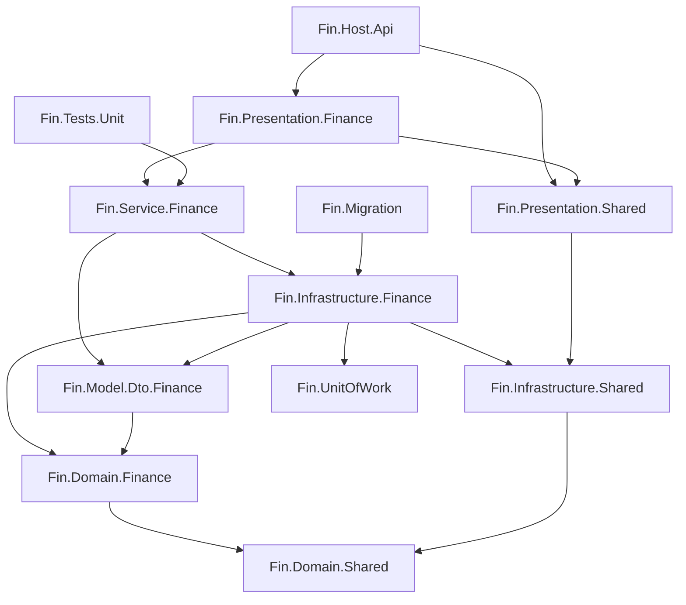

# Cấu trúc thư mục

```text
finance_shop_etsy/
├── backend/                               # API ASP.NET Core 9 — Clean Architecture
│   ├── Fin.Finance.sln
│   ├── Directory.Build.props              # net9.0, nullable, analyzer chặn API cấm
│   ├── Directory.Packages.props           # Central Package Management: version gói đặt ở đây
│   ├── BannedSymbols.txt                  # DateTime.Now / .Result / new HttpClient() → build lỗi
│   ├── global.json · .config/dotnet-tools.json (dotnet-ef 9)
│   ├── BuildingBlocks/                    # Code dùng chung, KHÔNG tham chiếu module
│   │   ├── Fin.Domain.Shared/             # BaseEntity, IEntity
│   │   ├── Fin.Infrastructure.Shared/     # Response<T>, PagedResult, ErrorCodeEnum, exception, ValidationBehavior
│   │   ├── Fin.UnitOfWork/                # IUnitOfWork, BaseUnitOfWork (EF Core, transaction)
│   │   └── Fin.Presentation.Shared/       # BaseApiController, ErrorHandlerMiddleware, versioning, Swagger, phục vụ frontend
│   ├── Modules/Finance/                   # Module nghiệp vụ duy nhất
│   │   ├── Fin.Domain.Finance/            # Entities, Constants — không phụ thuộc gì
│   │   ├── Fin.Model.Dto.Finance/         # Requests / Responses (hợp đồng JSON với frontend)
│   │   ├── Fin.Infrastructure.Finance/    # FinanceContext, Configurations, Migrations, Repositories,
│   │   │                                  # UnitOfWorks, Storage (file), External (Etsy, ECB), Seed, Options
│   │   ├── Fin.Service.Finance/           # UseCases/{Tính năng}/{Commands|Queries}/Handlers + Validators,
│   │   │                                  # Services (quy tắc dùng chung), Workers (tác vụ nền)
│   │   └── Fin.Presentation.Finance/      # Controllers/v1, Extensions (đăng ký DI cả module)
│   ├── Host/Fin.Host.Api/                 # Program.cs, appsettings.json, cổng 5000
│   │   ├── etsy.settings.example.json     # mẫu key Etsy → chép thành etsy.settings.json (không đưa lên git)
│   │   └── uploads/ · etsy.tokens.json · etsy.autosync.json   # dữ liệu chạy, không đưa lên git
│   ├── Migrations/Fin.Migration/          # Chương trình tạo / nâng cấp database + nạp dữ liệu mặc định
│   └── Tests/Fin.Tests.Unit/              # xUnit: quy tắc nghiệp vụ
├── frontend/                              # Giao diện HTML / CSS / JS thuần (không cần build)
│   ├── index.html
│   ├── css/style.css
│   └── js/
│       ├── api.js                         # gọi API, tự lấy "data" trong Response<T>
│       ├── store.js · format.js · icons.js · app.js
│       └── pages/                         # dashboard, records (thu / chi), reports, report-export, fx, history, trash
├── database/                              # Script SQL thời backend cũ (tham khảo; nay dùng Fin.Migration)
├── backend-legacy/                        # Backend cũ (Minimal API, SQL viết tay) — giữ để so sánh, có thể xóa
└── docs/                                  # Tài liệu này
```

## Quy tắc phụ thuộc giữa các project



- `Domain` không biết EF, HTTP hay MySQL.
- `BuildingBlocks` không tham chiếu `Modules`.
- Chỉ `Fin.Migration` được tạo / sửa bảng; API không tự migrate khi khởi động.
