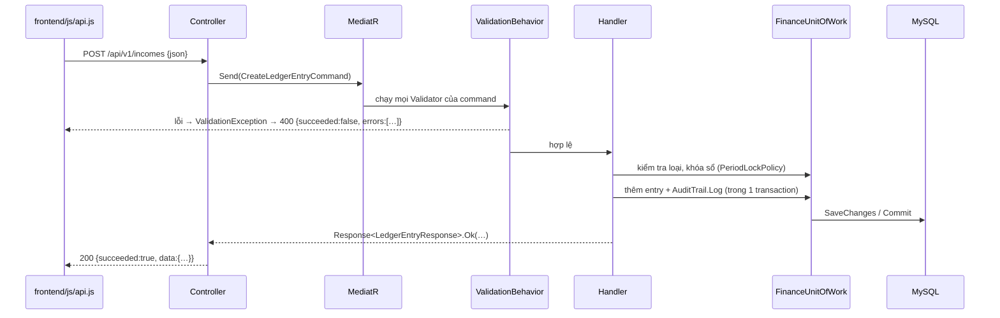

# Kiến trúc backend

Backend được viết lại theo khung **CMS_VSF**: Clean Architecture chia theo module, CQRS bằng MediatR, kiểm tra dữ liệu bằng FluentValidation, EF Core Code First với một chương trình migration riêng. Khác biệt so với CMS_VSF được ghi ở cuối trang.

## Các tầng của module Finance

| Tầng | Project | Chứa gì | Được phép biết |
|---|---|---|---|
| Domain | `Fin.Domain.Finance` | Entity (`LedgerEntry`, `Category`, …), hằng số nghiệp vụ, hành vi thuần (tính thuế, xóa mềm) | Không gì cả |
| DTO | `Fin.Model.Dto.Finance` | `…Request`, `…Response` — chính là JSON frontend nhận / gửi | Domain |
| Infrastructure | `Fin.Infrastructure.Finance` | `FinanceContext`, cấu hình bảng, migration, repository, UnitOfWork, lưu file, client Etsy / ECB, seeder | Domain, DTO, EF Core, MySQL, HTTP |
| Service | `Fin.Service.Finance` | Use case (Command / Query + Handler + Validator), dịch vụ nghiệp vụ dùng chung, tác vụ nền | Infrastructure (qua interface), DTO |
| Presentation | `Fin.Presentation.Finance` | Controller mỏng: nhận HTTP → gửi Command / Query → trả `Response<T>` | Service, DTO |
| Host | `Fin.Host.Api` | `Program.cs`: CORS, middleware, controller, phục vụ frontend | Presentation |

## Luồng một request

- **Lỗi nghiệp vụ** (trùng tên, khóa sổ, không tìm thấy…) do handler trả `Response.Fail(ErrorCodeEnum.X, câu báo)` với HTTP 200, `succeeded = false`.
- **Lỗi dữ liệu đầu vào** do Validator → `ValidationException` → middleware trả HTTP 400.
- **Lỗi hệ thống**: `ApiException` / `EtsyException` → 400; `DbException` → 500 "Không kết nối được MySQL…"; lỗi khác → 500 câu chung (bật `AppSetting:EnableErrorDetail` để xem chi tiết khi dev).
- `frontend/js/api.js` tự lấy `data` khi `succeeded = true`, và ném lỗi với `message` / `errors` khi `succeeded = false`.

## Các thành phần dùng chung trong Service

| Thành phần | Vai trò |
|---|---|
| `PeriodLockPolicy` | Khóa sổ theo quý / tháng + ngày ân hạn; sinh câu báo "Quý 3/2026 đã khóa sổ…" |
| `AuditTrail` | Ghi lịch sử; `Diff` so sánh 23 trường của khoản (số "29.00" = 29, chuỗi rỗng = không có) |
| `LedgerEntryAssembler` | Chép dữ liệu form vào entity (một chỗ cho cả thêm và sửa) |
| `AttachmentRules` | Loại file cho phép, giới hạn dung lượng, file nào xem được trên trình duyệt |
| `EtsyOrderMapper` | Đổi đơn Etsy thành khoản thu: VAT EU, tỷ giá tháng, ghi chú quy đổi / hoàn tiền |
| `EtsyOrderImporter` | Nhập đơn (bỏ đơn đã có), gán loại mặc định, ghi lịch sử — dùng cho cả nhập tay và tự động |
| `EtsyAutoSyncRunner` + `EtsyAutoSyncWorker` | Trạng thái và chu kỳ đồng bộ tự động; tác vụ nền kiểm tra mỗi phút |
| `TrashPurger` + `TrashCleanupWorker` | Xóa vĩnh viễn (dòng + file); tự dọn khoản quá 30 ngày khi khởi động và khi mở thùng rác |

## Quy ước code (theo CMS_VSF)

- Mỗi class một file; namespace khối `namespace X { … }`.
- Use case: `UseCases/{TínhNăng}/Commands/{Tên}Command.cs`, `Commands/Handlers/{Tên}Handler.cs`, `Validators/{Tên}Validator.cs` (tương tự cho `Queries`).
- Repository: `I{Entity}Repository` (Infrastructure/Interfaces) + `{Entity}Repository`; truy cập qua `IFinanceUnitOfWork`.
- **Không** comment mô tả trên khai báo (`/// 
`); comment chỉ bằng **tiếng Anh**, đặt trong thân hàm để giải thích *vì sao*. Chuỗi hiển thị cho người dùng giữ **tiếng Việt**.
- Cấm `DateTime.Now` / `DateTime.Today` (dùng `TimeProvider`), `.Result` / `.Wait()`, `new HttpClient()` — analyzer làm build lỗi (`BannedSymbols.txt`).
- Version gói NuGet chỉ khai ở `Directory.Packages.props`.
- Không tự migrate trong API; mọi thay đổi bảng đi qua migration + `Fin.Migration`.

## Khác biệt so với CMS_VSF

| CMS_VSF | Finance Shop Etsy | Lý do |
|---|---|---|
| .NET 10, SQL Server | .NET 9, MySQL / MariaDB (Pomelo) | Máy chạy có SDK 9; dữ liệu sẵn trên XAMPP |
| Nhiều module (Identity, Cms, Storage) | Một module `Finance` | Ứng dụng một người dùng, không cần đăng nhập |
| JWT, phân quyền `[HasPermissionFunctions]` | Không có | Chạy local, một người dùng |
| Khóa chính Guid | Khóa chính `long` (BIGINT UNSIGNED) | Giữ nguyên database và id hiện có |
| Khối bản quyền `#region FileHeader` | Không dùng | Dự án cá nhân, không thuộc Exps Software |
| Serilog | Logging mặc định của ASP.NET | Đủ cho chạy local |
| Body `{ "payload": {…} }` | Body là chính DTO | Giữ hợp đồng JSON frontend đang dùng |
