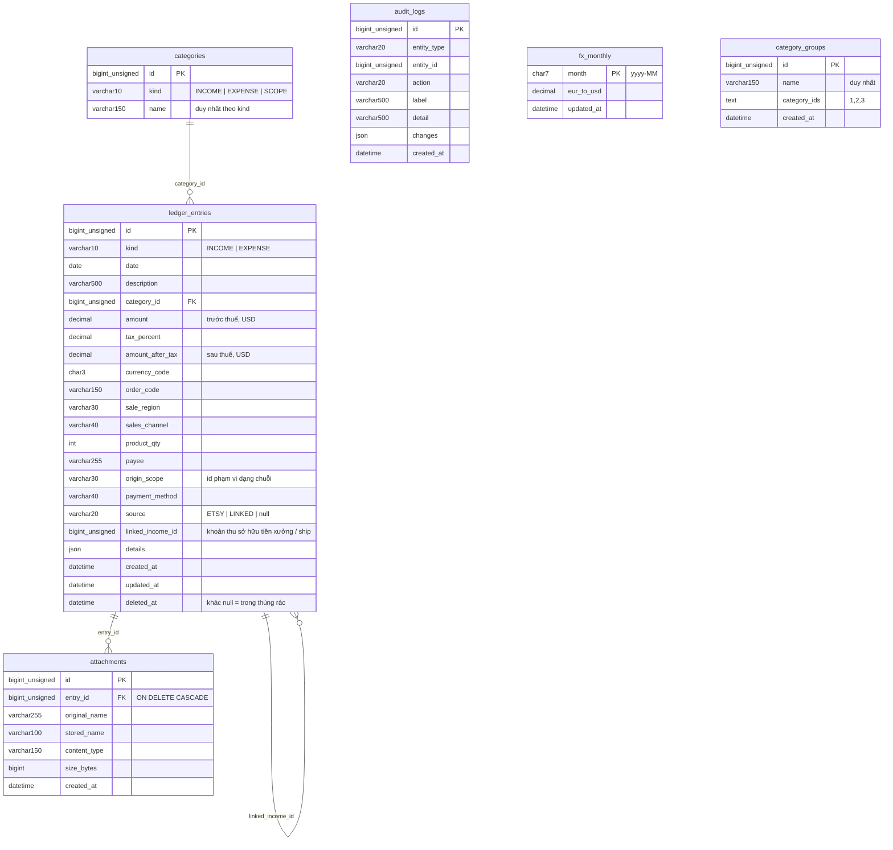

# Database

- Hệ quản trị: **MariaDB 10.4** (XAMPP), dùng được với MySQL 8. Chuỗi kết nối: `ConnectionStrings:Finance`.
- Một database `finance`, bảng mã `utf8mb4`.
- Schema do **EF Core migration** quản lý (`Fin.Infrastructure.Finance/Migrations`), áp dụng bằng chương trình `Fin.Migration`.

## Sơ đồ bảng



Chỉ mục: `idx_kind_date (kind, date)`, `idx_linked_income`, `idx_attachment_entry`, `idx_audit_created`, `idx_audit_entity (entity_type, entity_id)`, duy nhất `uq_kind_name`, `uq_group_name`.

## Migration

| Migration | Nội dung |
|---|---|
| `InitialSchema` | Đúng cấu trúc database do backend cũ tạo (6 bảng) |
| `AddLinkedIncomeId` | Thêm cột `linked_income_id` + chỉ mục; chuyển giá trị `linkedIncomeId` cũ từ JSON `details` sang cột |

### Chạy (tạo mới hoặc nâng cấp)

```bash
cd backend
dotnet run --project Migrations/Fin.Migration
```

Runner làm theo thứ tự:

1. **Nhận diện database cũ:** có bảng `ledger_entries` nhưng chưa có lịch sử EF → bổ sung các bảng / cột backend cũ có thể còn thiếu (`audit_logs`, `attachments`, `fx_monthly`, `category_groups`, cột `source`), rồi ghi `InitialSchema` là đã chạy. **Không xóa, không tạo lại bảng, dữ liệu giữ nguyên.**
2. Áp dụng các migration còn thiếu.
3. Nạp dữ liệu mặc định nếu còn trống: loại thu (Bán hàng = id 1, Thu khác), 10 loại chi, 2 phạm vi (Nội địa, Quốc tế); đổi giá trị phạm vi kiểu cũ `DOMESTIC` / `INTERNATIONAL` sang id phạm vi.

Chạy lại bao nhiêu lần cũng được; lần sau báo `Pending migrations for FinanceContext: 0`.

### Thêm migration mới

```bash
cd backend
dotnet tool restore
dotnet ef migrations add <TenThayDoi> --project Modules/Finance/Fin.Infrastructure.Finance --startup-project Migrations/Fin.Migration --context FinanceContext --output-dir Migrations
dotnet run --project Migrations/Fin.Migration
```

- Đặt tên theo thay đổi (`AddInvoiceDateColumn`), mỗi thay đổi một migration.
- Không sửa tay phần EF sinh ra; chỉ thêm `migrationBuilder.Sql(...)` khi cần chuyển dữ liệu.
- Không gọi `Migrate()` / `EnsureCreated()` trong API.

## Sao lưu

```bash
D:\xampp\mysql\bin\mysqldump.exe -h127.0.0.1 -P3307 -uroot finance > finance_backup.sql
```

Nên sao lưu trước khi chạy migration trên dữ liệu thật.
